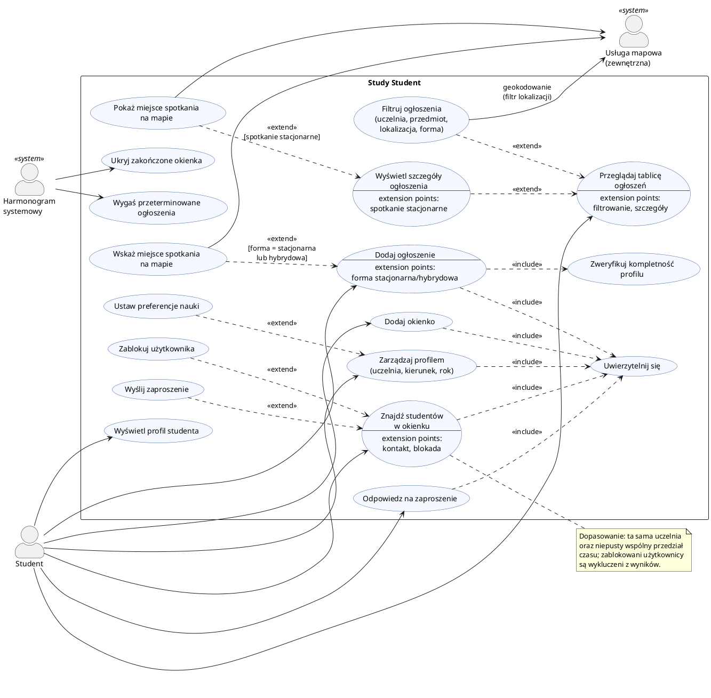

# Study Student – dokumentacja analityczna

| Pole | Wartość |
|---|---|
| Produkt | Study Student – aplikacja webowa do znajdowania partnerów do nauki i znajomych na uczelni |
| Wersja dokumentu | 1.0 (Draft) |
| Data | 2026-10-15 |
| Autor | Analityk Systemowy / Inżynier Wymagań |
| Stack (kontekst) | Python, środowisko VS Code |

**Spis treści**

1. [Historie użytkownika (User Stories)](#1-historie-użytkownika-user-stories)
2. [Diagram przypadków użycia (UML)](#2-diagram-przypadków-użycia-uml)
3. [Diagram wymagań (SysML)](#3-diagram-wymagań-sysml)
4. [Dokumentacja SDD – `.specify/spec.md`](#4-dokumentacja-sdd--specifyspecmd)

---

## 1. Historie użytkownika (User Stories)

Historie zapisano w formacie *Jako… chcę… aby…*. Każda obejmuje jeden obszar funkcjonalny opisany w kontekście projektu, a kryteria akceptacji zapisano w Gherkinie wyłącznie słowami kluczowymi **Given / When / Then** (warunki złożone łączone są w obrębie jednego kroku).

### Słownik wspólny

- **Student** – zalogowany użytkownik aplikacji.
- **Profil uzupełniony** – profil z wypełnionymi polami: uczelnia, kierunek, rok studiów.
- **Forma spotkania** – stacjonarna, online lub hybrydowa.
- **Okienko** – przerwa między zajęciami określona datą, godziną od–do i kampusem.

### US-01 – Profil studenta

> **Jako** student **chcę** uzupełnić profil o uczelnię, kierunek, rok studiów i preferencje nauki, **aby** inni studenci mogli ocenić, czy pasujemy do siebie jako partnerzy do nauki.

**Priorytet:** Must have · **Estymacja:** 3 SP

```gherkin
Feature: Profil studenta

  Scenario: Zapis kompletnego profilu
    Given zalogowany student bez uzupełnionego profilu
    When wybierze uczelnię i kierunek ze słownika, poda rok studiów od 1 do 5 i zapisze formularz
    Then system zapisuje profil i wyświetla komunikat "Profil zapisany"

  Scenario: Brak wymaganego pola uczelni
    Given zalogowany student w formularzu profilu
    When spróbuje zapisać formularz bez wybranej uczelni
    Then system nie zapisuje zmian i oznacza pole "Uczelnia" jako wymagane

  Scenario: Zapis preferencji nauki
    Given student z zapisanym profilem
    When zaznaczy preferencje nauki (forma, pora dnia, styl nauki) i zapisze zmiany
    Then preferencje są widoczne w publicznym podglądzie profilu

  Scenario: Ochrona danych kontaktowych w podglądzie publicznym
    Given inny zalogowany student
    When otworzy publiczny profil studenta
    Then widzi imię, uczelnię, kierunek, rok i preferencje, a adres e-mail nie jest wyświetlany
```

### US-02 – Dodanie ogłoszenia nauki

> **Jako** student **chcę** dodać ogłoszenie z przedmiotem, kierunkiem, opisem problemu i formą spotkania, **aby** znaleźć osoby, które pomogą mi lub będą się ze mną uczyć danego przedmiotu.

**Priorytet:** Must have · **Estymacja:** 5 SP

```gherkin
Feature: Dodawanie ogłoszenia

  Scenario: Publikacja poprawnego ogłoszenia online
    Given zalogowany student z uzupełnionym profilem
    When wypełni przedmiot, kierunek, opis problemu o długości od 20 do 1000 znaków, wybierze formę "online" i opublikuje ogłoszenie
    Then ogłoszenie pojawia się na tablicy ze statusem "Aktywne" i datą publikacji

  Scenario: Zbyt krótki opis problemu
    Given zalogowany student w formularzu ogłoszenia
    When wpisze opis krótszy niż 20 znaków i spróbuje opublikować ogłoszenie
    Then system blokuje publikację i wyświetla komunikat o minimalnej długości opisu

  Scenario: Brak uzupełnionego profilu
    Given zalogowany student bez uzupełnionego profilu
    When wybierze opcję "Dodaj ogłoszenie"
    Then system przekierowuje go do formularza profilu z informacją, że profil jest wymagany

  Scenario: Automatyczne wygaszenie ogłoszenia
    Given aktywne ogłoszenie opublikowane ponad 30 dni temu
    When zostanie uruchomione dzienne przetwarzanie wygasania ogłoszeń
    Then ogłoszenie otrzymuje status "Wygasłe" i nie jest wyświetlane na tablicy
```

### US-03 – Przeglądanie i filtrowanie ogłoszeń

> **Jako** student **chcę** filtrować ogłoszenia po uczelni, przedmiocie, lokalizacji i formie spotkania, **aby** szybko znaleźć tylko te propozycje nauki, które są dla mnie realne.

**Priorytet:** Must have · **Estymacja:** 5 SP

```gherkin
Feature: Przeglądanie i filtrowanie ogłoszeń

  Scenario: Filtr po uczelni
    Given tablica z aktywnymi ogłoszeniami z różnych uczelni
    When student ustawi filtr "Uczelnia = Politechnika Warszawska"
    Then lista zawiera wyłącznie ogłoszenia z tej uczelni

  Scenario: Łączenie filtrów
    Given ustawiony filtr uczelni
    When student doda filtry "Przedmiot = Analiza matematyczna" oraz "Forma = stacjonarna"
    Then lista zawiera wyłącznie ogłoszenia spełniające jednocześnie wszystkie trzy warunki

  Scenario: Filtr po lokalizacji
    Given student, który udostępnił swoją lokalizację
    When ustawi filtr "Lokalizacja: do 2 km"
    Then lista zawiera wyłącznie ogłoszenia stacjonarne z miejscem spotkania w promieniu 2 km

  Scenario: Brak wyników
    Given kombinacja filtrów, której nie spełnia żadne ogłoszenie
    When student zastosuje filtry
    Then system wyświetla komunikat "Brak ogłoszeń" i przycisk "Wyczyść filtry"

  Scenario: Trwałość filtrów w adresie strony
    Given student z ustawionymi filtrami
    When odświeży stronę lub otworzy skopiowany adres strony
    Then te same filtry są nadal zastosowane
```

### US-04 – Miejsce spotkania na mapie

> **Jako** autor ogłoszenia stacjonarnego **chcę** wskazać na mapie dokładne miejsce zbiórki, **aby** uczestnicy bez dodatkowych pytań trafili w to samo miejsce.

**Priorytet:** Should have · **Estymacja:** 5 SP

```gherkin
Feature: Miejsce spotkania na mapie

  Scenario: Wskazanie punktu zbiórki
    Given student tworzący ogłoszenie z formą "stacjonarna"
    When kliknie punkt na mapie i doda opis "wejście główne biblioteki, 2 piętro"
    Then ogłoszenie zapisuje współrzędne punktu oraz opis miejsca

  Scenario: Brak punktu dla spotkania stacjonarnego
    Given student tworzący ogłoszenie z formą "stacjonarna"
    When spróbuje opublikować ogłoszenie bez wskazania punktu na mapie
    Then system blokuje publikację i prosi o wskazanie miejsca na mapie

  Scenario: Spotkanie online nie wymaga mapy
    Given student tworzący ogłoszenie z formą "online"
    When otworzy formularz ogłoszenia
    Then sekcja mapy jest ukryta, a ogłoszenie można opublikować bez lokalizacji

  Scenario: Podgląd miejsca przez uczestnika
    Given opublikowane ogłoszenie stacjonarne z zapisanym punktem zbiórki
    When inny student otworzy szczegóły ogłoszenia
    Then widzi mapę z pinezką w zapisanym punkcie oraz opis miejsca
```

### US-05 – Znajomi na okienko

> **Jako** student **chcę** oznaczyć swoje okienko między zajęciami i zobaczyć innych studentów z mojej uczelni wolnych w tym samym czasie, **aby** poznać nowe osoby i dobrze wykorzystać przerwę.

**Priorytet:** Should have · **Estymacja:** 8 SP

```gherkin
Feature: Znajomi na okienko

  Scenario: Dodanie okienka
    Given zalogowany student z uzupełnionym profilem
    When doda okienko "dziś 12:00–13:30, kampus główny"
    Then okienko jest widoczne dla studentów tej samej uczelni do godziny jego zakończenia

  Scenario: Dopasowanie nakładających się okienek
    Given student A z okienkiem 12:00–13:30 i student B z okienkiem 13:00–14:00 na tej samej uczelni
    When student A otworzy listę "Wolni teraz w okienku"
    Then widzi studenta B z informacją o wspólnym czasie 13:00–13:30

  Scenario: Wysłanie zaproszenia
    Given student widzący innego studenta na liście okienek
    When wyśle zaproszenie z wiadomością "Kawa w bufecie?"
    Then adresat otrzymuje powiadomienie w aplikacji z możliwością akceptacji lub odrzucenia

  Scenario: Blokada użytkownika
    Given student, który zablokował innego użytkownika
    When zablokowany użytkownik przegląda listę okienek
    Then student blokujący nie jest widoczny na tej liście

  Scenario: Wygaśnięcie okienka
    Given okienko, którego godzina zakończenia minęła
    When dowolny student otworzy listę okienek
    Then to okienko nie jest wyświetlane
```

### Weryfikacja INVEST

| Kryterium | US-01 Profil | US-02 Ogłoszenie | US-03 Filtrowanie | US-04 Mapa | US-05 Okienka |
|---|---|---|---|---|---|
| **I**ndependent | Samodzielny moduł danych użytkownika | Wymaga tylko istnienia profilu (dane, nie implementacja innej historii) | Testowalne na danych zasilonych fixture'ami, bez UI dodawania | Rozszerza formularz ogłoszenia, wdrażalna osobno (feature flag) | Niezależna od tablicy ogłoszeń |
| **N**egotiable | Zakres preferencji do ustalenia z PO | Limity znaków i czas wygasania konfigurowalne | Lista filtrów i promienie negocjowalne | Wybór dostawcy map otwarty | Zasady widoczności i treść zaproszeń negocjowalne |
| **V**aluable | Buduje zaufanie i dopasowanie | Rdzeń wartości: zgłoszenie potrzeby nauki | Skraca czas znalezienia partnera | Eliminuje nieudane spotkania | Buduje sieć znajomości i zaangażowanie |
| **E**stimable | 3 SP | 5 SP | 5 SP | 5 SP | 8 SP |
| **S**mall | Mieści się w 1 sprincie | Mieści się w 1 sprincie | Mieści się w 1 sprincie | Mieści się w 1 sprincie | Mieści się w 1 sprincie (największa, można wydzielić blokowanie) |
| **T**estable | 4 scenariusze BDD | 4 scenariusze BDD | 5 scenariuszy BDD | 4 scenariusze BDD | 5 scenariuszy BDD |

---

## 2. Diagram przypadków użycia (UML)

Diagram obejmuje dokładnie zakres historii US-01…US-05. Aktorem głównym jest **Student**; aktorami drugoplanowymi (systemowymi) są **Usługa mapowa** (zewnętrzny dostawca map, np. OpenStreetMap) oraz **Harmonogram systemowy** (zadania cykliczne wygaszające ogłoszenia i okienka).



### Macierz śledzenia US ↔ UC

| Historia | Przypadki użycia |
|---|---|
| US-01 Profil studenta | UC00, UC01, UC02, UC03 |
| US-02 Dodanie ogłoszenia | UC00, UC04, UC05, UC06 |
| US-03 Przeglądanie i filtrowanie | UC07, UC08, UC09 |
| US-04 Miejsce spotkania na mapie | UC10, UC11 |
| US-05 Znajomi na okienko | UC00, UC12, UC13, UC14, UC15, UC16, UC17 |

---

## 3. Diagram wymagań (SysML)

### Klasyfikacja jakości

Ramę klasyfikacji wymagań jakościowych wyznacza **ISO/IEC 25002:2024** (Quality models overview and usage), która wskazuje model jakości produktu z **ISO/IEC 25010:2023**. Zastosowano jego 9 charakterystyk; wymagania funkcjonalne przypisano do charakterystyki **Functional suitability** (completeness, correctness, appropriateness), a wymagania niefunkcjonalne (NFR) do pozostałych.

| Charakterystyka ISO/IEC 25010:2023 | Wymagania | Metryki |
|---|---|---|
| Functional suitability | FR-001 … FR-017 | Pokrycie scenariuszami BDD = 100% |
| Performance efficiency | NFR-001, NFR-002, NFR-003 | Response time p95/p99, Throughput, Capacity, LCP |
| Reliability | NFR-004, NFR-005, NFR-006, NFR-007 | Availability, MTBF, MTTR, RPO, RTO |
| Security | NFR-008, NFR-009 | % ruchu TLS, zgodność ASVS, liczba podatności High/Critical |
| Interaction capability | NFR-010, NFR-011 | SUS, Task completion time, błędy WCAG |
| Flexibility | NFR-012 | Zakres rozdzielczości, macierz przeglądarek |
| Compatibility | NFR-013 | Zgodność ze specyfikacją OpenAPI, układ EPSG:4326 |
| Maintainability | NFR-014 | Code coverage, złożoność cyklomatyczna |
| Safety | – | Nie dotyczy (system nie steruje procesami fizycznymi) |

### Diagram

```plantuml
@startuml StudyStudent_SysML_Requirements
hide circle
hide methods
hide empty members
left to right direction
skinparam nodesep 40
skinparam ranksep 60
skinparam class {
  BackgroundColor<<requirement>> #FFFFFF
  BackgroundColor<<functionalRequirement>> #EAF3FF
  BackgroundColor<<performanceRequirement>> #FFF4E5
  BackgroundColor<<reliabilityRequirement>> #FFF4E5
  BackgroundColor<<securityRequirement>> #FDECEC
  BackgroundColor<<usabilityRequirement>> #EEF8EE
  BackgroundColor<<qualityRequirement>> #F4F0FA
  BackgroundColor<<testCase>> #F2F2F2
}

class "Study Student" as REQ0 <<requirement>> {
  id = "REQ-000"
  text = "System umożliwia studentom znalezienie partnerów do wspólnej nauki i nawiązywanie znajomości na uczelni."
}

package "Wymagania funkcjonalne\n[ISO/IEC 25010: Functional suitability]" as FUN {

  class "Profil studenta" as FRG1 <<requirement>> {
    id = "FR-G1"
    text = "Obsługa profilu studenta (US-01)."
  }
  class "Profil – dane" as FR001 <<functionalRequirement>> {
    id = "FR-001"
    text = "Tworzenie i edycja profilu: uczelnia, kierunek, rok, preferencje."
  }
  class "Profil – walidacja" as FR002 <<functionalRequirement>> {
    id = "FR-002"
    text = "Uczelnia, kierunek i rok są wymagane."
  }
  class "Profil – podgląd" as FR003 <<functionalRequirement>> {
    id = "FR-003"
    text = "Publiczny podgląd profilu bez adresu e-mail."
  }

  class "Ogłoszenia" as FRG2 <<requirement>> {
    id = "FR-G2"
    text = "Tablica ogłoszeń nauki (US-02)."
  }
  class "Dodanie ogłoszenia" as FR004 <<functionalRequirement>> {
    id = "FR-004"
    text = "Przedmiot, kierunek, opis 20–1000 znaków, forma spotkania; wymaga profilu."
  }
  class "Zarządzanie ogłoszeniem" as FR005 <<functionalRequirement>> {
    id = "FR-005"
    text = "Edycja, zamknięcie i usunięcie własnego ogłoszenia."
  }
  class "Wygasanie ogłoszeń" as FR006 <<functionalRequirement>> {
    id = "FR-006"
    text = "Status 'Wygasłe' po 30 dniach."
  }

  class "Wyszukiwanie" as FRG3 <<requirement>> {
    id = "FR-G3"
    text = "Przeglądanie i filtrowanie ogłoszeń (US-03)."
  }
  class "Lista ogłoszeń" as FR007 <<functionalRequirement>> {
    id = "FR-007"
    text = "Lista od najnowszych, paginacja po 20."
  }
  class "Filtrowanie" as FR008 <<functionalRequirement>> {
    id = "FR-008"
    text = "Filtry: uczelnia, przedmiot, lokalizacja (promień), forma; łączone AND."
  }
  class "Filtry w URL" as FR009 <<functionalRequirement>> {
    id = "FR-009"
    text = "Aktywne filtry odzwierciedlone w adresie URL."
  }

  class "Mapa spotkań" as FRG4 <<requirement>> {
    id = "FR-G4"
    text = "Wskazywanie miejsca zbiórki (US-04)."
  }
  class "Wskazanie punktu" as FR010 <<functionalRequirement>> {
    id = "FR-010"
    text = "Punkt WGS84 wymagany dla formy stacjonarnej/hybrydowej + opis do 200 znaków."
  }
  class "Podgląd punktu" as FR011 <<functionalRequirement>> {
    id = "FR-011"
    text = "Mapa z pinezką w szczegółach ogłoszenia."
  }

  class "Okienka" as FRG5 <<requirement>> {
    id = "FR-G5"
    text = "Szukanie znajomych na okienka (US-05)."
  }
  class "Dodanie okienka" as FR012 <<functionalRequirement>> {
    id = "FR-012"
    text = "Data, godziny od–do, kampus; auto-ukrycie po zakończeniu."
  }
  class "Dopasowanie okienek" as FR013 <<functionalRequirement>> {
    id = "FR-013"
    text = "Lista studentów tej samej uczelni z nakładającym się okienkiem i wspólnym przedziałem."
  }
  class "Zaproszenia" as FR014 <<functionalRequirement>> {
    id = "FR-014"
    text = "Zaproszenie z wiadomością do 200 znaków; akceptacja/odrzucenie."
  }
  class "Blokowanie" as FR015 <<functionalRequirement>> {
    id = "FR-015"
    text = "Zablokowani nie widzą okienek ani profilu blokującego."
  }

  class "Uwierzytelnianie" as FR016 <<functionalRequirement>> {
    id = "FR-016"
    text = "Tworzenie i edycja treści wymaga zalogowania."
  }
  class "Zgłaszanie treści" as FR017 <<functionalRequirement>> {
    id = "FR-017"
    text = "Zgłoszenie ogłoszenia lub profilu jako nieodpowiedniego."
  }
}

package "Wymagania niefunkcjonalne (NFR)\n[ISO/IEC 25002 / 25010]" as NFR {

  package "Performance efficiency" {
    class "Czas odpowiedzi filtrów" as NFR001 <<performanceRequirement>> {
      id = "NFR-001"
      subcharacteristic = "Time behaviour"
      metric = "Response time API"
      threshold = "p95 ≤ 500 ms; p99 ≤ 1 s @ 10 000 ogłoszeń"
      verifyMethod = "Test obciążeniowy (Locust)"
    }
    class "Pojemność" as NFR002 <<performanceRequirement>> {
      id = "NFR-002"
      subcharacteristic = "Capacity"
      metric = "Concurrent users, Throughput, Error rate"
      threshold = "≥ 500 użytk.; ≥ 100 req/s; błędy < 1%"
      verifyMethod = "Test obciążeniowy"
    }
    class "Ładowanie mapy" as NFR003 <<performanceRequirement>> {
      id = "NFR-003"
      subcharacteristic = "Time behaviour"
      metric = "Largest Contentful Paint"
      threshold = "LCP ≤ 2,5 s (p75, 4G)"
      verifyMethod = "Lighthouse / RUM"
    }
  }

  package "Reliability" {
    class "Dostępność" as NFR004 <<reliabilityRequirement>> {
      id = "NFR-004"
      subcharacteristic = "Availability"
      metric = "Availability = uptime / czas całkowity"
      threshold = "≥ 99,5% / miesiąc"
      verifyMethod = "Monitoring syntetyczny (co 1 min)"
    }
    class "Bezawaryjność" as NFR005 <<reliabilityRequirement>> {
      id = "NFR-005"
      subcharacteristic = "Faultlessness"
      metric = "MTBF"
      threshold = "≥ 720 h"
      verifyMethod = "Analiza incydentów (kwartalnie)"
    }
    class "Odtwarzalność" as NFR006 <<reliabilityRequirement>> {
      id = "NFR-006"
      subcharacteristic = "Recoverability"
      metric = "MTTR, RPO, RTO"
      threshold = "MTTR ≤ 1 h; RPO ≤ 24 h; RTO ≤ 4 h"
      verifyMethod = "Test odtworzenia z kopii (DR drill)"
    }
    class "Odporność na awarię map" as NFR007 <<reliabilityRequirement>> {
      id = "NFR-007"
      subcharacteristic = "Fault tolerance"
      metric = "% operacji CRUD ogłoszeń przy niedostępnym API map"
      threshold = "100%"
      verifyMethod = "Test z zaślepką awarii (fault injection)"
    }
  }

  package "Security" {
    class "Poufność danych" as NFR008 <<securityRequirement>> {
      id = "NFR-008"
      subcharacteristic = "Confidentiality"
      metric = "% ruchu po TLS ≥ 1.2; wycieki danych osobowych"
      threshold = "100%; 0 wycieków"
      verifyMethod = "Skan TLS, testy penetracyjne"
    }
    class "Uwierzytelnianie i integralność" as NFR009 <<securityRequirement>> {
      id = "NFR-009"
      subcharacteristic = "Authenticity, Integrity"
      metric = "Zgodność OWASP ASVS L1; podatności High/Critical"
      threshold = "100% wymagań L1; 0 podatności"
      verifyMethod = "SAST (Bandit), SCA (pip-audit), audyt ASVS"
    }
  }

  package "Interaction capability" {
    class "Łatwość użycia" as NFR010 <<usabilityRequirement>> {
      id = "NFR-010"
      subcharacteristic = "Operability, Learnability"
      metric = "SUS; czas i skuteczność zadania"
      threshold = "SUS ≥ 75; ≥ 90% dodaje ogłoszenie w ≤ 2 min"
      verifyMethod = "Test użyteczności (n ≥ 10)"
    }
    class "Dostępność cyfrowa" as NFR011 <<usabilityRequirement>> {
      id = "NFR-011"
      subcharacteristic = "Inclusivity"
      metric = "Błędy krytyczne WCAG 2.1 AA"
      threshold = "0"
      verifyMethod = "axe-core w CI + audyt ręczny"
    }
  }

  package "Flexibility / Compatibility / Maintainability" {
    class "Responsywność" as NFR012 <<qualityRequirement>> {
      id = "NFR-012"
      subcharacteristic = "Flexibility: Adaptability"
      metric = "Szerokość ekranu; macierz przeglądarek"
      threshold = "360–1920 px; 2 ostatnie wersje Chrome, Firefox, Safari, Edge"
      verifyMethod = "Testy E2E (Playwright) w macierzy"
    }
    class "Interoperacyjność" as NFR013 <<qualityRequirement>> {
      id = "NFR-013"
      subcharacteristic = "Compatibility: Interoperability"
      metric = "Zgodność API z OpenAPI 3.x; układ współrzędnych"
      threshold = "100% endpointów opisanych; EPSG:4326"
      verifyMethod = "Walidacja schematu w CI"
    }
    class "Utrzymywalność" as NFR014 <<qualityRequirement>> {
      id = "NFR-014"
      subcharacteristic = "Maintainability: Testability, Modifiability"
      metric = "Code coverage; złożoność cyklomatyczna; błędy lint/typów"
      threshold = "≥ 80%; ≤ 10 / funkcję; 0"
      verifyMethod = "pytest-cov, radon, ruff, mypy w CI"
    }
  }
}

package "Weryfikacja" as VER {
  class "BDD US-01..US-05" as TC_BDD <<testCase>> {
    text = "Scenariusze Given-When-Then z sekcji 1"
  }
  class "Test obciążeniowy" as TC_LOAD <<testCase>>
  class "DR drill" as TC_DR <<testCase>>
  class "Audyt bezpieczeństwa" as TC_SEC <<testCase>>
}

' --- Zawieranie (containment) ---
REQ0 +-- FRG1
REQ0 +-- FRG2
REQ0 +-- FRG3
REQ0 +-- FRG4
REQ0 +-- FRG5
REQ0 +-- FR016
REQ0 +-- FR017
FRG1 +-- FR001
FRG1 +-- FR002
FRG1 +-- FR003
FRG2 +-- FR004
FRG2 +-- FR005
FRG2 +-- FR006
FRG3 +-- FR007
FRG3 +-- FR008
FRG3 +-- FR009
FRG4 +-- FR010
FRG4 +-- FR011
FRG5 +-- FR012
FRG5 +-- FR013
FRG5 +-- FR014
FRG5 +-- FR015

REQ0 +-- NFR001
REQ0 +-- NFR004
REQ0 +-- NFR008
REQ0 +-- NFR010
REQ0 +-- NFR012

' --- Relacje między wymaganiami ---
NFR001 ..> FR008 : <<refine>>
NFR002 ..> FR007 : <<refine>>
NFR003 ..> FR011 : <<refine>>
NFR007 ..> FR010 : <<deriveReqt>>
NFR008 ..> FR003 : <<deriveReqt>>
NFR008 ..> FR015 : <<trace>>
NFR009 ..> FR016 : <<deriveReqt>>
NFR010 ..> FR004 : <<refine>>
NFR013 ..> FR010 : <<trace>>
NFR005 ..> NFR004 : <<deriveReqt>>
NFR006 ..> NFR004 : <<deriveReqt>>

' --- Weryfikacja ---
TC_BDD ..> FRG1 : <<verify>>
TC_BDD ..> FRG2 : <<verify>>
TC_BDD ..> FRG3 : <<verify>>
TC_BDD ..> FRG4 : <<verify>>
TC_BDD ..> FRG5 : <<verify>>
TC_LOAD ..> NFR001 : <<verify>>
TC_LOAD ..> NFR002 : <<verify>>
TC_DR ..> NFR006 : <<verify>>
TC_SEC ..> NFR009 : <<verify>>

@enduml
```

PlantUML nie ma natywnego profilu SysML, dlatego diagram wymagań modelowany jest stereotypami SysML (`<<requirement>>`, `<<functionalRequirement>>`, `<<performanceRequirement>>`, `<<testCase>>`) oraz relacjami `<<deriveReqt>>`, `<<refine>>`, `<<verify>>`, `<<trace>>` i zawieraniem (`+--`). Każde NFR ma atrybuty **metric**, **threshold** i **verifyMethod**.



### Macierz śledzenia US ↔ FR ↔ NFR

| Historia | Wymagania funkcjonalne | Powiązane NFR |
|---|---|---|
| US-01 | FR-001, FR-002, FR-003, FR-016 | NFR-008, NFR-010, NFR-011 |
| US-02 | FR-004, FR-005, FR-006, FR-016, FR-017 | NFR-009, NFR-010 |
| US-03 | FR-007, FR-008, FR-009 | NFR-001, NFR-002 |
| US-04 | FR-010, FR-011 | NFR-003, NFR-007, NFR-013 |
| US-05 | FR-012, FR-013, FR-014, FR-015 | NFR-008 |
| Wszystkie | – | NFR-004, NFR-005, NFR-006, NFR-012, NFR-014 |

---

## 4. Dokumentacja SDD – `.specify/spec.md`

Specyfikację przygotowano w strukturze szablonu **GitHub Spec Kit** (`spec-template.md`): sekcje *User Scenarios & Testing*, *Requirements*, *Key Entities*, *Success Criteria* oraz znaczniki `[NEEDS CLARIFICATION]` dla otwartych decyzji. Zgodnie z filozofią Spec Kit plik opisuje **co** i **dlaczego**; stack Pythonowy trafi do `plan.md` generowanego komendą `/plan` (w nowszych wersjach Spec Kit pliki funkcji leżą w `specs/001-study-student-mvp/spec.md`, a katalog `.specify/` zawiera szablony i `memory/constitution.md`).

Treść pliku do skopiowania:

````markdown
# Feature Specification: Study Student – platforma kojarzenia studentów do wspólnej nauki

**Feature Branch**: `001-study-student-mvp`
**Created**: 2026-10-15
**Status**: Draft
**Input**: Opis interesariusza: „Aplikacja webowa ułatwiająca studentom znalezienie osób do wspólnej nauki z konkretnych przedmiotów oraz nawiązywanie nowych znajomości na uczelni (tablica ogłoszeń, filtrowanie, profil studenta, mapa miejsc spotkań, sekcja społecznościowa „okienka”)”.

> Niniejsza specyfikacja opisuje **CO** system ma robić i **DLACZEGO**. Decyzje technologiczne (Python, framework webowy, baza danych, dostawca map) należą do `plan.md` i nie są tu przesądzane.

---

## User Scenarios & Testing *(mandatory)*

### User Story 1 – Profil studenta (Priority: P1)

Jako **student** chcę **uzupełnić profil o uczelnię, kierunek, rok studiów i preferencje nauki**, aby **inni studenci mogli ocenić, czy pasujemy do siebie jako partnerzy do nauki**.

**Why this priority**: Profil jest warunkiem wstępnym dla ogłoszeń i sekcji społecznościowej (autor ogłoszenia musi być identyfikowalny), a pola uczelni i kierunku zasilają domyślne filtry.

**Independent Test**: Zarejestrowany student uzupełnia i zapisuje profil, a następnie widzi go w trybie podglądu publicznego, bez użycia innych funkcji.

**Acceptance Scenarios**:

1. **Given** zalogowany student bez uzupełnionego profilu, **When** wybierze uczelnię i kierunek ze słownika, poda rok studiów od 1 do 5 i zapisze formularz, **Then** system zapisuje profil i wyświetla komunikat „Profil zapisany”.
2. **Given** zalogowany student w formularzu profilu, **When** spróbuje zapisać formularz bez wybranej uczelni, **Then** system nie zapisuje zmian i oznacza pole „Uczelnia” jako wymagane.
3. **Given** student z zapisanym profilem, **When** zaznaczy preferencje nauki (forma: stacjonarna / online, pora dnia, styl: cicha nauka / dyskusja) i zapisze, **Then** preferencje są widoczne w publicznym podglądzie profilu.
4. **Given** inny zalogowany student, **When** otworzy publiczny profil studenta, **Then** widzi imię, uczelnię, kierunek, rok i preferencje oraz nie widzi adresu e-mail.

---

### User Story 2 – Dodanie ogłoszenia nauki (Priority: P1)

Jako **student** chcę **dodać ogłoszenie z przedmiotem, kierunkiem, opisem problemu i formą spotkania**, aby **znaleźć osoby, które pomogą mi lub będą się ze mną uczyć danego przedmiotu**.

**Why this priority**: Rdzeń wartości produktu; bez ogłoszeń tablica i filtrowanie nie mają treści.

**Independent Test**: Student z uzupełnionym profilem publikuje ogłoszenie i widzi je jako pierwsze na liście „Moje ogłoszenia” oraz na tablicy.

**Acceptance Scenarios**:

1. **Given** zalogowany student z uzupełnionym profilem, **When** wypełni przedmiot, kierunek, opis problemu (20–1000 znaków), formę spotkania „online” i opublikuje ogłoszenie, **Then** ogłoszenie pojawia się na tablicy ze statusem „Aktywne” i datą publikacji.
2. **Given** zalogowany student w formularzu ogłoszenia, **When** wpisze opis krótszy niż 20 znaków, **Then** system blokuje publikację i wyświetla komunikat o minimalnej długości opisu.
3. **Given** zalogowany student bez uzupełnionego profilu, **When** wybierze „Dodaj ogłoszenie”, **Then** system przekierowuje go do formularza profilu z informacją, że profil jest wymagany.
4. **Given** aktywne ogłoszenie starsze niż 30 dni, **When** nastąpi dzienne przetwarzanie wygasania, **Then** ogłoszenie otrzymuje status „Wygasłe” i znika z tablicy.

---

### User Story 3 – Przeglądanie i filtrowanie ogłoszeń (Priority: P1)

Jako **student** chcę **filtrować ogłoszenia po uczelni, przedmiocie, lokalizacji i formie spotkania**, aby **szybko znaleźć tylko te propozycje nauki, które są dla mnie realne**.

**Why this priority**: Bez filtrowania tablica przestaje być użyteczna przy większej liczbie ogłoszeń; to druga połowa podstawowej pętli wartości (dodaj → znajdź).

**Independent Test**: Na zbiorze testowych ogłoszeń zastosowanie kombinacji filtrów zwraca wyłącznie pasujące rekordy.

**Acceptance Scenarios**:

1. **Given** tablica z ogłoszeniami z różnych uczelni, **When** student ustawi filtr „Uczelnia = Politechnika Warszawska”, **Then** lista zawiera wyłącznie ogłoszenia z tej uczelni.
2. **Given** ustawiony filtr uczelni, **When** student doda filtry „Przedmiot = Analiza matematyczna” i „Forma = stacjonarna”, **Then** lista zawiera wyłącznie ogłoszenia spełniające wszystkie trzy warunki jednocześnie.
3. **Given** student z udostępnioną lokalizacją, **When** ustawi filtr „Lokalizacja: do 2 km”, **Then** lista zawiera wyłącznie ogłoszenia stacjonarne z miejscem spotkania w promieniu 2 km.
4. **Given** kombinacja filtrów bez wyników, **When** student zastosuje filtry, **Then** system wyświetla komunikat „Brak ogłoszeń” i przycisk „Wyczyść filtry”.
5. **Given** ustawione filtry, **When** student odświeży stronę lub skopiuje jej adres, **Then** te same filtry są nadal zastosowane.

---

### User Story 4 – Miejsce spotkania na mapie (Priority: P2)

Jako **autor ogłoszenia stacjonarnego** chcę **wskazać na mapie dokładne miejsce zbiórki**, aby **uczestnicy bez dodatkowych pytań trafili w to samo miejsce**.

**Why this priority**: Zwiększa skuteczność spotkań stacjonarnych, ale ogłoszenia działają bez niej (forma online, opis tekstowy).

**Independent Test**: Autor ustawia pinezkę w ogłoszeniu stacjonarnym, a inny student widzi to samo miejsce na mapie w szczegółach ogłoszenia.

**Acceptance Scenarios**:

1. **Given** student tworzący ogłoszenie z formą „stacjonarna”, **When** kliknie punkt na mapie i doda opis „wejście główne biblioteki, 2 piętro”, **Then** ogłoszenie zapisuje współrzędne punktu i opis miejsca.
2. **Given** student tworzący ogłoszenie z formą „stacjonarna”, **When** spróbuje opublikować ogłoszenie bez wskazania punktu, **Then** system blokuje publikację i prosi o wskazanie miejsca na mapie.
3. **Given** student tworzący ogłoszenie z formą „online”, **When** otworzy formularz, **Then** sekcja mapy jest ukryta, a ogłoszenie można opublikować bez lokalizacji.
4. **Given** opublikowane ogłoszenie stacjonarne, **When** inny student otworzy jego szczegóły, **Then** widzi mapę z pinezką w zapisanym punkcie i opisem miejsca.

---

### User Story 5 – Znajomi na okienko (Priority: P2)

Jako **student** chcę **oznaczyć swoje okienko między zajęciami i zobaczyć innych studentów z mojej uczelni wolnych w tym samym czasie**, aby **poznać nowe osoby i dobrze wykorzystać przerwę**.

**Why this priority**: Funkcja społecznościowa budująca zaangażowanie; niezależna od tablicy ogłoszeń, ale niekrytyczna dla MVP nauki.

**Independent Test**: Dwóch studentów tej samej uczelni z nakładającymi się okienkami widzi się nawzajem na liście i może wysłać zaproszenie.

**Acceptance Scenarios**:

1. **Given** zalogowany student z profilem, **When** doda okienko „dziś 12:00–13:30, kampus główny”, **Then** okienko jest widoczne dla innych studentów tej samej uczelni do godziny jego zakończenia.
2. **Given** student A z okienkiem 12:00–13:30 i student B z okienkiem 13:00–14:00 na tej samej uczelni, **When** student A otworzy listę „Wolni teraz w okienku”, **Then** widzi studenta B z informacją o wspólnym czasie 13:00–13:30.
3. **Given** student widzący innego studenta na liście okienek, **When** wyśle zaproszenie „Kawa w bufecie?”, **Then** adresat otrzymuje powiadomienie w aplikacji z możliwością akceptacji lub odrzucenia.
4. **Given** student, który zablokował innego użytkownika, **When** zablokowany użytkownik przegląda listę okienek, **Then** blokujący student nie jest na niej widoczny.
5. **Given** okienko, którego godzina zakończenia minęła, **When** dowolny student otworzy listę okienek, **Then** to okienko nie jest wyświetlane.

---

### Edge Cases

- Uczelni lub przedmiotu nie ma w słowniku → student zgłasza propozycję wpisu; do czasu akceptacji ogłoszenie trafia do kategorii „Inne”. [NEEDS CLARIFICATION: kto moderuje słowniki uczelni i przedmiotów?]
- Student nie udostępnił lokalizacji przeglądarki → filtr „Lokalizacja” działa na podstawie ręcznie wybranego kampusu lub miasta.
- Dostawca map jest niedostępny → formularz ogłoszenia stacjonarnego pozwala zapisać tekstowy opis miejsca, a pinezkę można dodać później; szczegóły pokazują opis zamiast mapy.
- Nakładające się okienka tego samego studenta → system scala je w jeden przedział.
- Ogłoszenie zawiera treści obraźliwe lub dane osobowe osób trzecich → każdy student może je zgłosić; po 3 zgłoszeniach ogłoszenie jest ukrywane do weryfikacji.
- Usunięcie konta → ogłoszenia, okienka i zaproszenia użytkownika są usuwane lub anonimizowane (RODO, art. 17).

---

## Requirements *(mandatory)*

### Functional Requirements

**Profil (US-1)**
- **FR-001**: System MUST umożliwiać zalogowanemu studentowi utworzenie i edycję profilu z polami: uczelnia, kierunek, rok studiów, preferencje nauki.
- **FR-002**: System MUST wymagać pól uczelnia, kierunek i rok studiów przed zapisem profilu.
- **FR-003**: System MUST udostępniać publiczny podgląd profilu innym zalogowanym studentom, bez ujawniania adresu e-mail.

**Ogłoszenia (US-2)**
- **FR-004**: System MUST umożliwiać studentowi z uzupełnionym profilem dodanie ogłoszenia z polami: przedmiot, kierunek, opis problemu (20–1000 znaków), forma spotkania (stacjonarna / online / hybrydowa).
- **FR-005**: System MUST umożliwiać autorowi edycję, zamknięcie i usunięcie własnego ogłoszenia.
- **FR-006**: System MUST automatycznie oznaczać ogłoszenia jako „Wygasłe” po 30 dniach od publikacji.

**Tablica i filtrowanie (US-3)**
- **FR-007**: System MUST prezentować aktywne ogłoszenia w kolejności od najnowszych, z paginacją po 20 pozycji.
- **FR-008**: System MUST umożliwiać filtrowanie ogłoszeń po uczelni, przedmiocie, lokalizacji (promień od punktu) i formie spotkania, łącząc filtry koniunkcją (AND).
- **FR-009**: System MUST odzwierciedlać aktywne filtry w adresie URL.

**Mapa (US-4)**
- **FR-010**: System MUST wymagać wskazania punktu na mapie dla ogłoszeń o formie „stacjonarna” lub „hybrydowa” i zapisywać współrzędne (WGS84) oraz opcjonalny opis miejsca (do 200 znaków).
- **FR-011**: System MUST wyświetlać mapę z pinezką miejsca spotkania w szczegółach ogłoszenia stacjonarnego.

**Okienka (US-5)**
- **FR-012**: System MUST umożliwiać studentowi dodanie okienka (data, godzina od–do, kampus) i automatycznie ukrywać je po jego zakończeniu.
- **FR-013**: System MUST wyświetlać listę studentów tej samej uczelni z okienkiem nakładającym się na okienko użytkownika, wraz ze wspólnym przedziałem czasu.
- **FR-014**: System MUST umożliwiać wysłanie zaproszenia z krótką wiadomością (do 200 znaków) oraz jego akceptację lub odrzucenie przez adresata.
- **FR-015**: System MUST umożliwiać blokowanie użytkowników; zablokowani użytkownicy nie widzą okienek ani profilu blokującego.

**Wspólne**
- **FR-016**: System MUST wymagać uwierzytelnienia dla wszystkich funkcji tworzenia i edycji treści. [NEEDS CLARIFICATION: czy rejestracja ma być ograniczona do adresów e-mail w domenach uczelnianych?]
- **FR-017**: System MUST umożliwiać zgłoszenie ogłoszenia lub profilu jako nieodpowiedniego.

### Non-Functional Requirements

Klasyfikacja wg ramy ISO/IEC 25002:2024 i modelu jakości produktu ISO/IEC 25010:2023.

| ID | Charakterystyka (podcharakterystyka) | Wymaganie | Metryka i próg |
|---|---|---|---|
| **NFR-001** | Performance efficiency (Time behaviour) | Lista ogłoszeń z filtrami odpowiada szybko. | Czas odpowiedzi API p95 ≤ 500 ms, p99 ≤ 1 s przy 10 000 aktywnych ogłoszeń |
| **NFR-002** | Performance efficiency (Capacity) | System obsługuje szczyt sesji. | ≥ 500 równoczesnych użytkowników i ≥ 100 req/s przy błędach < 1% |
| **NFR-003** | Performance efficiency (Time behaviour) | Widok mapy ładuje się płynnie. | LCP ≤ 2,5 s (p75, sieć 4G) |
| **NFR-004** | Reliability (Availability) | Usługa jest dostępna w okresie akademickim. | Availability ≥ 99,5% miesięcznie (≤ 3 h 39 min niedostępności) |
| **NFR-005** | Reliability (Faultlessness) | Awarie zdarzają się rzadko. | MTBF ≥ 720 h |
| **NFR-006** | Reliability (Recoverability) | Awarie są szybko usuwane, dane nie giną. | MTTR ≤ 1 h; RPO ≤ 24 h; RTO ≤ 4 h |
| **NFR-007** | Reliability (Fault tolerance) | Awaria dostawcy map nie blokuje ogłoszeń. | 100% operacji CRUD ogłoszeń działa przy niedostępnym API map |
| **NFR-008** | Security (Confidentiality) | Dane osobowe są chronione zgodnie z RODO. | 100% ruchu po TLS ≥ 1.2; e-mail niewidoczny publicznie; 0 wycieków w testach |
| **NFR-009** | Security (Authenticity, Integrity) | Uwierzytelnianie i dane są odporne na typowe ataki. | Zgodność z OWASP ASVS 4.0 L1; hasła Argon2id/bcrypt; 0 podatności High/Critical w skanie SAST/SCA przed wydaniem |
| **NFR-010** | Interaction capability (Operability, Learnability) | Kluczowe zadania są proste. | SUS ≥ 75; ≥ 90% nowych użytkowników dodaje ogłoszenie w ≤ 2 min |
| **NFR-011** | Interaction capability (Inclusivity) | Interfejs jest dostępny. | WCAG 2.1 AA: 0 błędów krytycznych w audycie automatycznym |
| **NFR-012** | Flexibility (Adaptability) | Aplikacja działa na urządzeniach studentów. | Poprawne działanie na szerokościach 360–1920 px i w 2 ostatnich wersjach Chrome, Firefox, Safari, Edge |
| **NFR-013** | Compatibility (Interoperability) | Integracje są oparte na standardach. | API opisane w OpenAPI 3.x; współrzędne w WGS84 (EPSG:4326) |
| **NFR-014** | Maintainability (Testability, Modifiability) | Kod jest łatwy w utrzymaniu. | Pokrycie testami ≥ 80% linii; złożoność cyklomatyczna ≤ 10 na funkcję; 0 błędów lintera i kontroli typów w CI |

### Key Entities

- **Student**: konto użytkownika; e-mail, hasło (hash), data rejestracji, lista zablokowanych użytkowników.
- **Profil**: 1:1 ze Studentem; uczelnia, kierunek, rok studiów, preferencje nauki.
- **Uczelnia / Kierunek / Przedmiot**: słowniki; Przedmiot należy do Kierunku, Kierunek do Uczelni.
- **Ogłoszenie**: autor (Student), przedmiot, kierunek, opis problemu, forma spotkania, status (Aktywne / Zamknięte / Wygasłe / Ukryte), data publikacji, opcjonalne Miejsce spotkania.
- **Miejsce spotkania**: współrzędne (WGS84), opis tekstowy.
- **Okienko**: Student, data, godzina od–do, kampus.
- **Zaproszenie**: nadawca, adresat, okienko, wiadomość, status (Wysłane / Zaakceptowane / Odrzucone).
- **Zgłoszenie**: zgłaszający, obiekt (Ogłoszenie lub Profil), powód, data.

---

## Success Criteria *(mandatory)*

### Measurable Outcomes

- **SC-001**: ≥ 90% nowych użytkowników uzupełnia profil i publikuje pierwsze ogłoszenie w czasie ≤ 2 minut (test użyteczności, n ≥ 10).
- **SC-002**: ≥ 40% aktywnych ogłoszeń otrzymuje co najmniej jedną odpowiedź w ciągu 72 godzin od publikacji.
- **SC-003**: 95% zapytań z filtrami zwraca wynik w ≤ 500 ms przy 10 000 aktywnych ogłoszeń.
- **SC-004**: ≥ 80% uczestników spotkań stacjonarnych ocenia wskazanie miejsca jako „wystarczające do trafienia bez dopytywania” (ankieta po spotkaniu).
- **SC-005**: ≥ 25% użytkowników aktywnych w miesiącu dodaje co najmniej jedno okienko.
- **SC-006**: Dostępność usługi ≥ 99,5% w każdym miesiącu semestru.

---

## Review & Acceptance Checklist

- [x] Brak szczegółów implementacyjnych (języki, frameworki, API) w treści wymagań
- [x] Wymagania są testowalne i jednoznaczne
- [x] Kryteria sukcesu są mierzalne i niezależne od technologii
- [x] Każda historia użytkownika ma niezależny test i scenariusze akceptacji
- [ ] Wszystkie znaczniki `[NEEDS CLARIFICATION]` rozstrzygnięte
````
